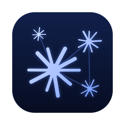
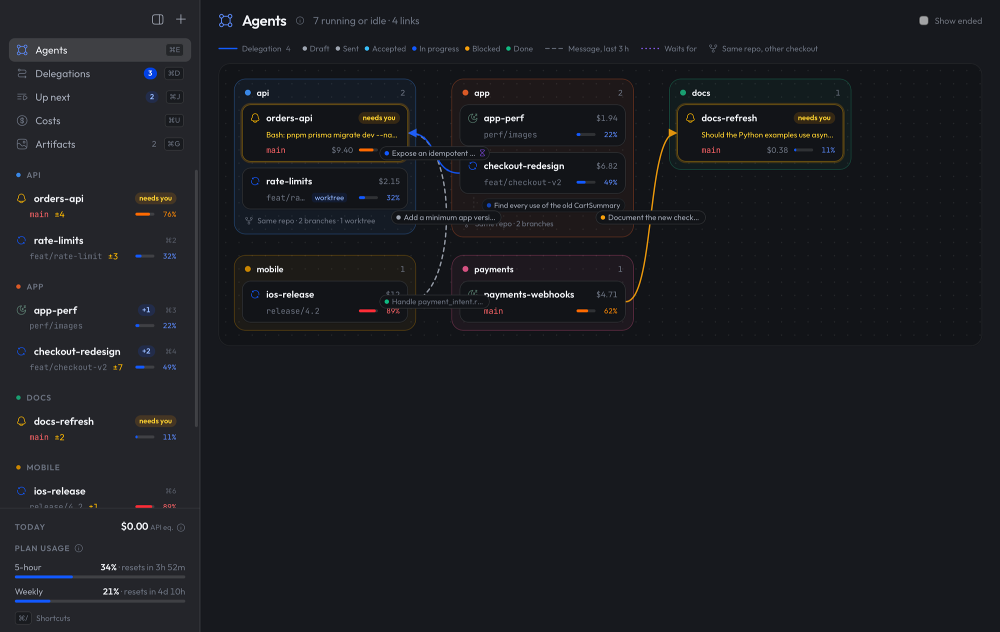
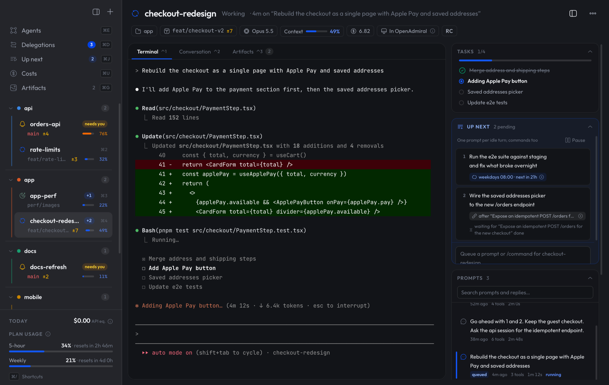
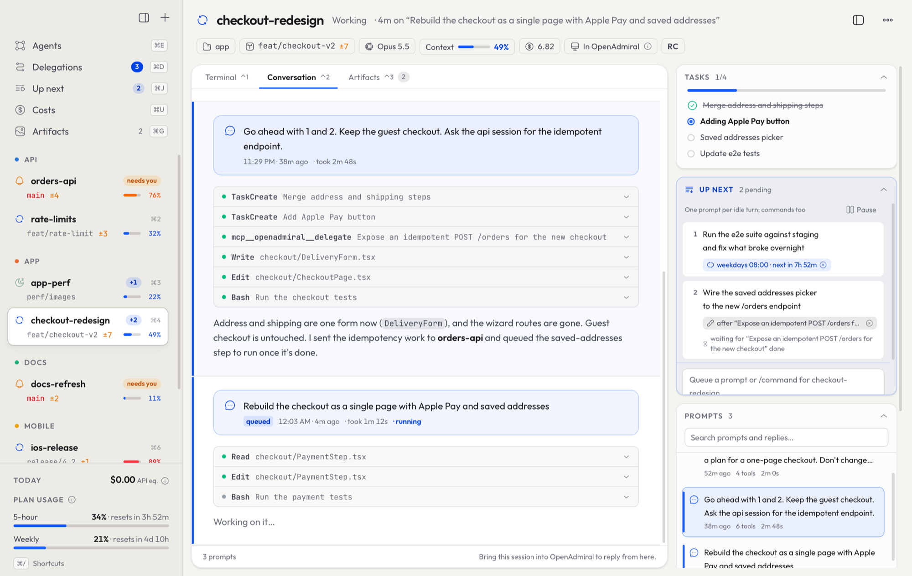
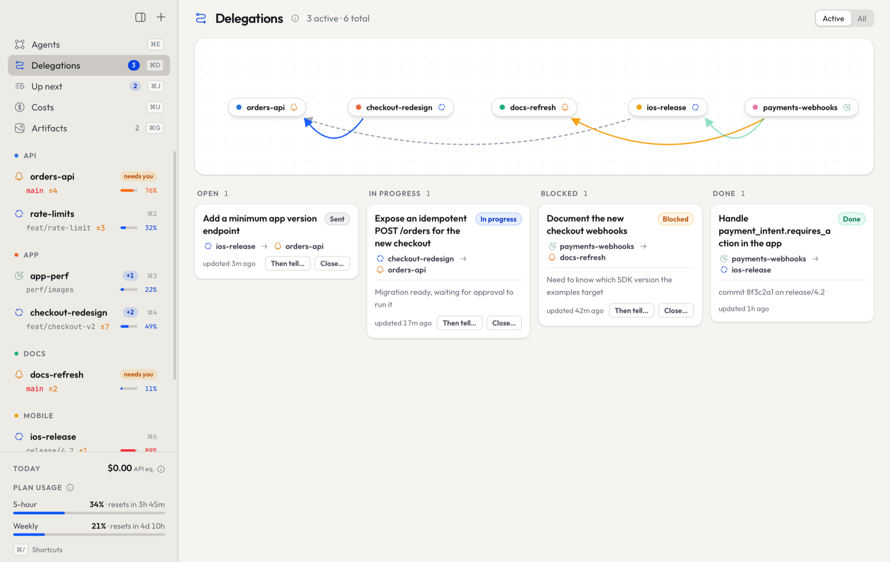
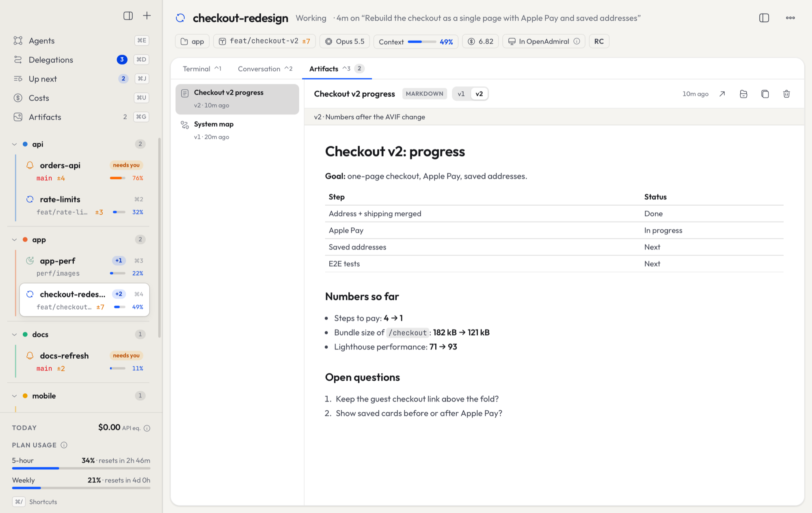
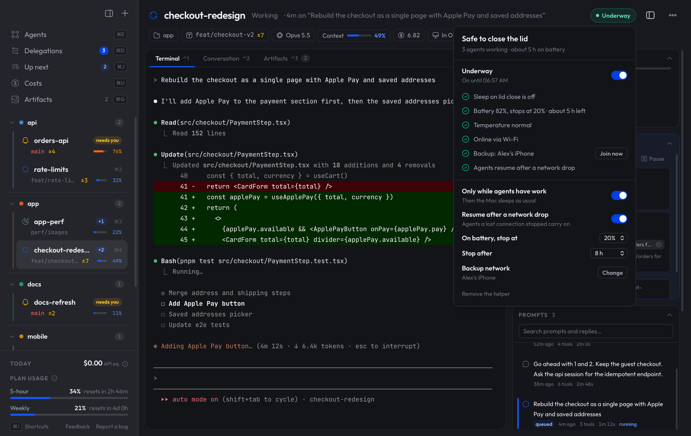

<div align="center">



# OpenAdmiral

### Command a fleet of AI agents from a single bridge.

You stopped writing every line yourself. Now stop babysitting every terminal.<br>
OpenAdmiral gives your Claude Code sessions everything a desktop app does well,<br>
without taking away anything the terminal does best.

<br>



<sub>macOS · free and open source · early alpha</sub>

</div>

<br>

## The problem

AI coding agents got good: good enough to trust one with a feature, a migration or a release.
So you open another one. And another. One fixes the API, one rebuilds the checkout, one writes
the docs, one ships the iOS build.

Then the bottleneck turns out to be you.

- **You can't see your own fleet.** Six terminals, six tabs, six scrollbacks. Which one is done? Which one is stuck?
- **The agent that needs you waits in silence.** It asked for a permission twenty minutes ago, behind a window you weren't looking at.
- **Your agents can't talk to each other.** The frontend needs an endpoint from the backend, so *you* become the messenger, copying context from one terminal to another.
- **Work stops when you do.** Close the laptop and nothing moves. The follow-up you meant to send at 8 am never gets sent.
- **The results get buried.** The report, the diagram, the plan you asked for scroll away under thousands of lines of output.

More agents should mean more done. Without a way to command them, it just means more
windows to watch.

## Terminal power, desktop comfort

Claude Code in the terminal is the most capable way to build with Claude: every command,
plugin, hook and MCP server, your shell, your editor, your keyboard. That's why the people
who build the most with it live there.

But a terminal shows one session at a time, in plain text, and only while you're looking.
It can't tap you on the shoulder, draw you a diagram or tell you what the other five agents
are doing. Desktop apps fix that by asking you to leave the terminal behind.

We don't think you should have to choose.

<table>
<tr>
<th width="50%" align="left">What you keep: the terminal</th>
<th width="50%" align="left">What you gain: the app</th>
</tr>
<tr>
<td valign="top">

- The real Claude Code, with every feature the day it ships
- Your plugins, hooks, skills, MCP servers and settings
- Your terminal, your editor, your shortcuts: keep working in your own terminal, or right inside OpenAdmiral
- Sessions that keep running in the background, with or without the app open

</td>
<td valign="top">

- Every session at a glance, and the ones that need you first
- A notification the moment an agent is waiting on you
- Reports, plans, diagrams and pages rendered, not printed
- Every conversation readable and searchable, long after it scrolled away
- Agents that hand work to each other, queues and schedules
- What it all costs, and how much of your plan is left
- Close the lid and keep going: agents keep working on the road

</td>
</tr>
</table>

## The shift: from operator to admiral

An admiral doesn't steer every ship. They watch the whole fleet and step in only when
a ship needs them.

That is the job OpenAdmiral gives you back.

<table>
<tr>
<td width="50%" valign="top">

### 🧭 See everything at a glance
Every session from every project in one window: what it is working on, how far
along it is, how much context it has left and what it costs. The ones that need you
rise to the top.

</td>
<td width="50%" valign="top">

### 🔔 Step in only when it matters
When an agent asks for a permission or a decision, you hear about it. One click
takes you into its terminal, inside the app, to answer and move on.

</td>
</tr>
<tr>
<td valign="top">

### 🤝 Agents that work together
An agent can hand a piece of work to another agent with a clear brief, and that
agent reports back as it goes. You watch the work flow between them instead of
carrying it yourself.

</td>
<td valign="top">

### 🌙 Work that keeps moving without you
Line up what each agent should do next. It runs when the agent is free, once
another agent's work lands, or on a schedule, waking a closed session up if it
has to.

</td>
</tr>
<tr>
<td valign="top">

### 📚 Every result, in one place
Reports, plans, diagrams and pages your agents produce are collected and versioned
beside their work. Every conversation is kept too, readable and searchable long
after the terminal has scrolled on.

</td>
<td valign="top">

### 💰 No surprises on the bill
What each project costs today and this month, and how much of your plan you have
left before the limit, always in view.

</td>
</tr>
</table>

## A look inside

<table>
  <tr>
    <td></td>
    <td></td>
  </tr>
  <tr>
    <td align="center"><b>Take the helm.</b> The agent's own terminal, right in the app, with <b>Up next</b> beside it: prompts that run when it's free, after another agent delivers, or on a schedule.</td>
    <td align="center"><b>Read the log.</b> The whole conversation, every prompt, tool call and reply, searchable even when you were never attached.</td>
  </tr>
  <tr>
    <td></td>
    <td></td>
  </tr>
  <tr>
    <td align="center"><b>Watch the crew coordinate.</b> Work handed between agents, from sent to done, and what is blocked on whom.</td>
    <td align="center"><b>Collect the results.</b> What your agents publish for you to see, every version kept.</td>
  </tr>
</table>

## Close the lid. The fleet keeps sailing.

Your agents run on your Mac, and a Mac goes to sleep the moment its lid closes. Turn on
**Underway** and it stays awake for as long as your agents have work, then sleeps as
usual. Before you pack up, one look at the top right answers the only question that
matters: *Safe to close the lid*.

It looks after the Mac while you're away. It stops on its own before the battery runs
low, if the Mac runs too hot, or after the time you set. And when the connection drops
on the road, your agents don't lose the thread: OpenAdmiral switches to your iPhone's
hotspot if you set one up, and they carry on where they stopped.

<p align="center"></p>

## A day with OpenAdmiral

It's 9 am. Overnight, a scheduled prompt ran the end-to-end suite and an agent has
already fixed what broke. You open OpenAdmiral and see the whole fleet: two agents
working, one finished with a report waiting, one asking a question.

You answer the question. You ask the checkout agent for a one-page redesign; it sees it
needs a new endpoint and hands that to the API agent. You line up its next step to run the
moment the endpoint lands, and go to a meeting.

When you're back, the endpoint is merged, the checkout is half rebuilt, and the progress
report is sitting in Artifacts. You didn't copy a single line between terminals.

At six, two agents are still going. The top right says *Safe to close the lid*, so you
close it and drive home. They finish on the way.

## Built on what you already use

- **Your Claude Code, unchanged.** No new agent, no wrapper, no other model. OpenAdmiral
  is a Claude Code mod: it plugs into Claude Code's own extension system, with no patching,
  no screen-scraping and nothing standing between you and your sessions. Remove it and
  everything is exactly as it was.
- **Local-first.** 100% local: your code and sessions never leave your Mac. No account.
  One anonymous daily ping counts installs, and you can turn it off
  ([what it sends](https://openadmiral.com/privacy)).
- **Open source.** MIT licensed. Read it, change it, make it yours.

## Get started

**1. Add the plugin** in any Claude Code session:

```
/plugin marketplace add OpenAdmiral/openadmiral
/plugin install openadmiral@openadmiral
```

Run `/reload-plugins` in sessions that were already open.

**2. Install the app.** [Download OpenAdmiral](https://openadmiral.com/download) (Apple Silicon
and Intel), open the `.dmg` and drag OpenAdmiral to Applications. It is signed and notarized by
Apple, so it opens like any other app. From then on it updates itself;
see [what's new](https://openadmiral.com/releases) in every version.

<details>
<summary>Or build it from source</summary>

<br>

Requires [Rust](https://rustup.rs), Node 20+ and pnpm.

```sh
git clone https://github.com/OpenAdmiral/openadmiral.git
cd openadmiral/app && pnpm install && scripts/install.sh
```

</details>

Open **OpenAdmiral** from your Applications folder. Every session with the plugin shows up on its own.

**3. Optional: Underway.** To keep agents working with the lid closed, click **Docked** at
the top right, turn Underway on and install its helper. macOS asks you to allow it once.

## Where we're heading

OpenAdmiral is an early alpha with a simple conviction: the future of building software
is one person directing many agents, and that person deserves a real bridge, not a pile
of terminal tabs. Next on the horizon:

- **Your fleet in your pocket.** Notifications, approvals, queues and results from your phone.
- **Beyond macOS.**

Ideas, issues and pull requests are welcome.

## About

OpenAdmiral is mission control for your Claude Code sessions: every agent in one window, a nudge
when one needs you, and agents that hand work to each other. It's free, open source and made by
[César Trigo](https://github.com/CesarTrigo). Find out more, download it and see what's new at
**[openadmiral.com](https://openadmiral.com)**.

### Thank you, open source

OpenAdmiral stands on the work of these projects and the people who maintain them:
[Tauri](https://tauri.app) ·
[React](https://react.dev) ·
[Tailwind CSS](https://tailwindcss.com) ·
[xterm.js](https://xtermjs.org) ·
[Motion](https://motion.dev) ·
[dnd kit](https://dndkit.com) ·
[TanStack Virtual](https://tanstack.com/virtual) ·
[Mermaid](https://mermaid.js.org) ·
[react-markdown](https://github.com/remarkjs/react-markdown) ·
[highlight.js](https://highlightjs.org) ·
[Solar Icons](https://www.npmjs.com/package/@solar-icons/react) ·
[Outfit](https://fonts.google.com/specimen/Outfit) and [JetBrains Mono](https://www.jetbrains.com/lp/mono/) ·
[portable-pty](https://github.com/wezterm/wezterm/tree/main/pty) from WezTerm ·
[notify](https://github.com/notify-rs/notify) ·
[ccusage](https://github.com/ryoppippi/ccusage) ·
[Vite](https://vite.dev) and [Vitest](https://vitest.dev).

<details>
<summary><b>For contributors</b></summary>

<br>

OpenAdmiral has two parts that only talk through JSON files under `~/.claude/openadmiral/`:

- **`plugin/`**: a Claude Code plugin that runs inside every session, publishes its state
  and gives agents the `delegate`, `delegation_update`, `status` and `show` tools.
- **`app/`**: a Tauri 2 + React app that reads those files, embeds terminals and writes
  requests back (queued prompts, hand-offs, renames).

[`docs/CONTRACT.md`](docs/CONTRACT.md) is the source of truth for every file and field.

```sh
cd app && pnpm tauri dev               # run in development
cd app && pnpm exec vitest run         # frontend tests
cd app/src-tauri && cargo test         # backend tests
claude plugin test plugin              # plugin tests
```

The screenshots come from a preview instance running on made-up data
([`app/scripts/demo-data.py`](app/scripts/demo-data.py) explains how).

</details>

---

<sub>OpenAdmiral is an independent open source project, not affiliated with or endorsed by Anthropic. Claude and Claude Code are trademarks of Anthropic. [MIT License](LICENSE).</sub>
